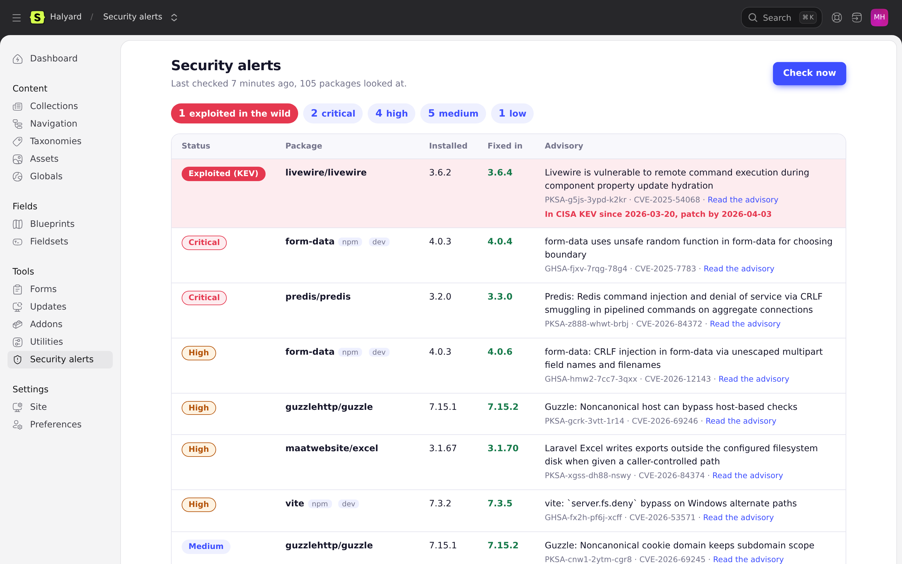
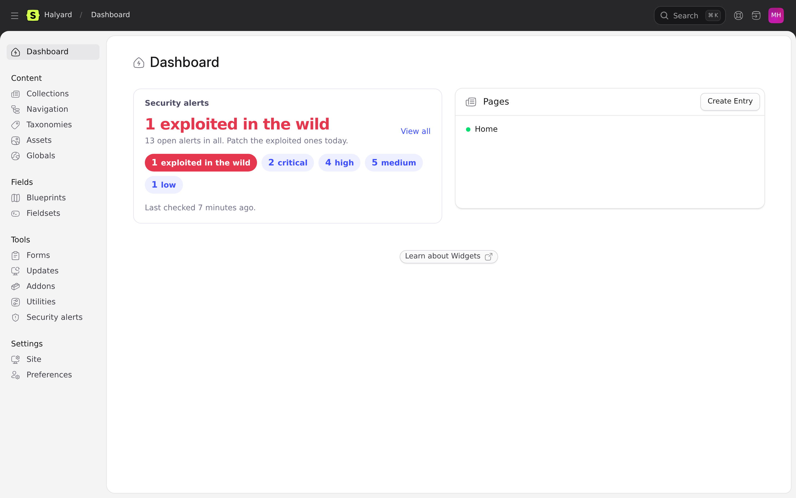
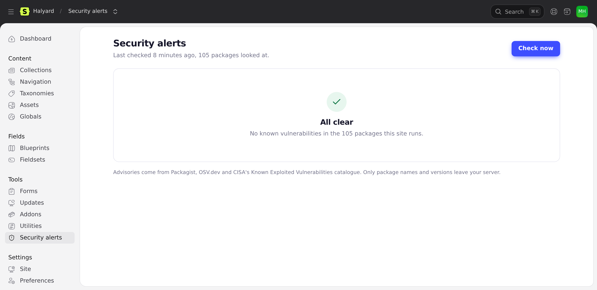
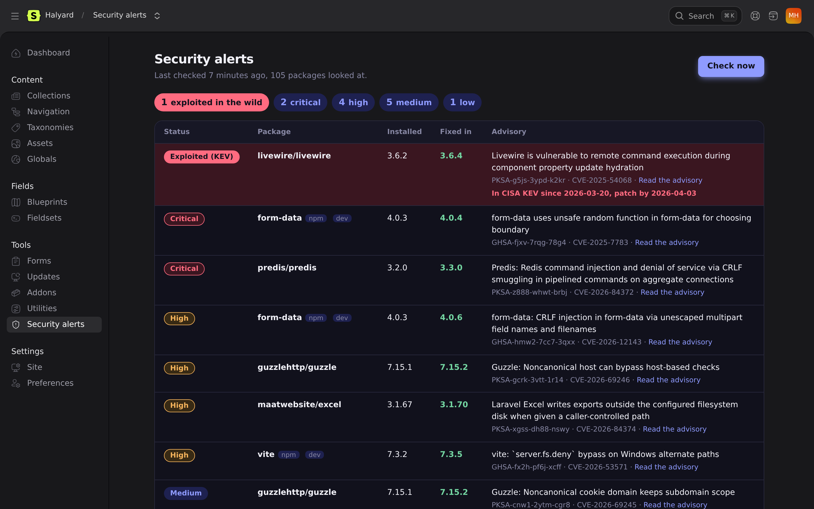
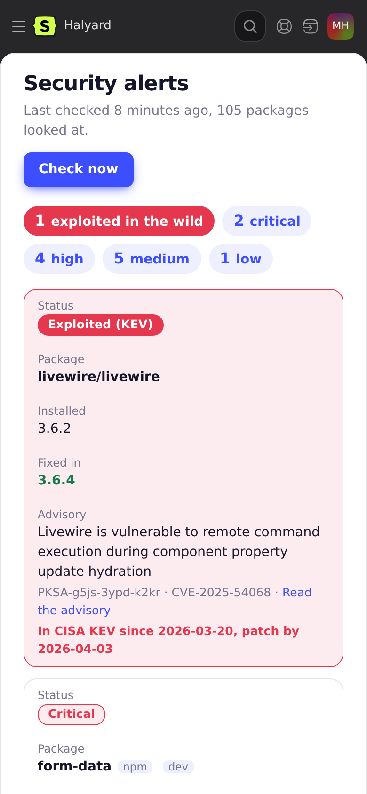

<p align="center">
  
</p>

<p align="center">
  <a href="#install"><strong>Install</strong></a> &nbsp;&nbsp;&nbsp;
  <a href="#permissions"><strong>Permissions</strong></a> &nbsp;&nbsp;&nbsp;
  <a href="#for-developers"><strong>Developers</strong></a> &nbsp;&nbsp;&nbsp;
  <a href="CHANGELOG.md"><strong>Changelog</strong></a>
</p>

<p align="center">
  <a href="https://github.com/Ruvelo/statamic-security-alerts/actions/workflows/tests.yml"></a>
  
  
  
  <a href="LICENSE"></a>
</p>

# Statamic Security Alerts

**See which of your installed packages are vulnerable, from the Control Panel.** A Security alerts page and a dashboard widget for Statamic, built on [ruvelo/laravel-security-alerts](https://github.com/Ruvelo/laravel-security-alerts). Flaws that attackers are already exploiting are listed first, marked KEV, with the version that fixes them.

```
composer require ruvelo/statamic-security-alerts
php artisan migrate
php artisan security-alerts:check --notify
```

Then open **Tools, Security alerts** in the Control Panel.

## A quick tour

**Exploited now, patch today.** Advisories for the Composer and npm packages in your lockfiles are matched against CISA's catalogue of [known exploited vulnerabilities](https://www.cisa.gov/known-exploited-vulnerabilities-catalog). Those go to the top, whatever their score, with the day CISA listed them and the version to update to. Everything else follows by severity.

<table>
  <tr>
    <td width="50%"></td>
    <td width="50%"></td>
  </tr>
  <tr>
    <td><strong>On the dashboard</strong>: counts, red when anything is exploited, when it last ran, and a warning after 48 hours without a check.</td>
    <td><strong>All clear</strong> when nothing is open, so a quiet page means it checked, not that it didn't.</td>
  </tr>
  <tr>
    <td width="50%"></td>
    <td width="50%"></td>
  </tr>
  <tr>
    <td><strong>Light and dark</strong>, following the Control Panel.</td>
    <td><strong>At phone width</strong> each finding becomes a card.</td>
  </tr>
</table>

## Features

- **A Security alerts page** under Tools: findings from the last check, exploited first, then critical, high, medium and low, each with installed and fixed-in versions and a link to the advisory.
- **Check now**: runs a fresh check from the page, protected by CSRF and the permission.
- **A dashboard widget** with counts, red when anything is exploited, and a stale warning after 48 hours.
- **A permission**, `view security alerts`, so you decide which roles see it.
- **Statamic 5 and 6**, with plain Blade views and one stylesheet: no JavaScript build.
- **No network from the page.** It reads the table the check fills; only a check (the scheduler, the command or Check now) calls Valtry's Advisory API or, as a fallback, Packagist, OSV.dev and CISA, and only package names (and, for the public feeds, versions) leave your server.
- Everything else comes from laravel-security-alerts: the daily schedule, mail and Slack notifications, events and the artisan command.

Watching many sites? [Valtry](https://valtry.co.uk/?utm_source=ruvelo&utm_medium=github&utm_campaign=statamic-security-alerts) scans them from the outside.

## Requirements

- PHP 8.3 or 8.4
- Statamic 5 or 6 (Laravel 12, or 13 with Statamic 6)
- The Laravel [scheduler](https://laravel.com/docs/scheduling#running-the-scheduler) running. This matters on Statamic sites, which often skip it: without a cron entry running `php artisan schedule:run` every minute, the daily check never happens, and the page and widget warn that they are out of date.

## Install

```
composer require ruvelo/statamic-security-alerts
php artisan migrate
```

`ruvelo/laravel-security-alerts` comes with it and registers its own daily check at 07:00, so add the cron entry if you don't have one:

```
* * * * * cd /path/to/site && php artisan schedule:run >> /dev/null 2>&1
```

Run a first check right away, from the page with **Check now**, or from the terminal:

```
php artisan security-alerts:check --notify
```

Add `--fail-on=exploited` to fail a CI pipeline, or `--json` to feed another tool. To be emailed when something new turns up, set `SECURITY_ALERTS_MAIL=you@example.com` in `.env`. The [laravel-security-alerts README](https://github.com/Ruvelo/laravel-security-alerts#configuration) lists every option (Slack, schedule time, minimum severity, weekly digest).

The addon's stylesheet is published for you when Statamic installs the addon. If the page looks unstyled, publish it by hand:

```
php artisan vendor:publish --tag=security-alerts --force
```

### Add the widget

The widget is available as `security_alerts`. Add it in `config/statamic/cp.php`:

```php
'widgets' => [
    ['type' => 'security_alerts', 'width' => 50],
],
```

Users without the permission don't see it.

## Permissions

The addon registers **View security alerts** under Permissions in Users, Roles. Grant it to the roles that should see the page and the widget, and run a check. Super users always can. A user who can open the Control Panel but lacks the permission gets a 403 on the page, and no nav item.

## For developers

The page reads `Ruvelo\SecurityAlerts\SecurityAlerts::open()` and `lastCheck()` (see the [PHP API](https://github.com/Ruvelo/laravel-security-alerts#php-api)); it never writes to the alerts table except through `SecurityAlerts::check()`.

- The CP routes are `security-alerts.index` (GET) and `security-alerts.check` (POST), so `cp_route('security-alerts.index')` links to the page.
- To change the markup, put your own `index.blade.php` or `widget.blade.php` in `resources/views/vendor/statamic-security-alerts/` in your site. The vendor publish tag only copies the stylesheet.
- The last check is remembered in your cache. If a deploy clears it, open alerts still show when they were last confirmed, and the next check restores the package count.

## Statamic Marketplace listing

Notes for submitting the addon at [statamic.com/addons](https://statamic.com/addons) (free addon, MIT):

- **Name:** Security Alerts. **Handle/package:** `ruvelo/statamic-security-alerts`. **Price:** free. **Compatibility:** Statamic 5 and 6.
- **Tagline:** Vulnerable packages, exploited ones first, in the Control Panel.
- **Description:** use the first two paragraphs of this README, then the install steps. The screenshots are in `art/` (page, dashboard, dark, mobile, empty state and the Statamic 5 dashboard).
- **Categories:** Security, Developer tools. **Source and support:** this repository and its issues.
- Tag a release (`v1.0.0`) on GitHub and submit it from the Statamic Marketplace seller dashboard. The addon's `composer.json` already carries the `statamic-addon` type and the `extra.statamic` name and description the Marketplace reads.
- **Packagist:** laravel-security-alerts (and its core, security-advisories) must be on Packagist before this addon can be installed from there; until then sites need `composer config repositories.lsa vcs https://github.com/Ruvelo/laravel-security-alerts` and `composer config repositories.sa vcs https://github.com/Ruvelo/security-advisories`.

## Contributing

Pull requests are welcome. Clone, `composer install`, then `composer check` runs code style (Pint), static analysis (PHPStan level 6) and the tests, exactly as CI does. The tests never touch the network. See [CONTRIBUTING.md](CONTRIBUTING.md) and the [changelog](CHANGELOG.md).

## Credits

Built by [François Bultez](https://github.com/francoisbultez) at [Valtry](https://valtry.co.uk/?utm_source=ruvelo&utm_medium=github&utm_campaign=statamic-security-alerts), the website security scanner, and everyone who [contributes](https://github.com/Ruvelo/statamic-security-alerts/graphs/contributors).

Advisories come from [Packagist](https://packagist.org), [OSV.dev](https://osv.dev) and [CISA](https://www.cisa.gov/known-exploited-vulnerabilities-catalog), through laravel-security-alerts. Thanks to everyone who maintains them.

## License

MIT. See [LICENSE](LICENSE).
